Développeuse web en formation  Je développe mes compétences avec **React, TypeScript et Node.js**.   Actuellement, je travaille sur **BADDIES**, une application dédiée aux premiers gestes pour les douleurs menstruelles.   Mon objectif : concevoir des projets utiles, avec une attention particulière au design et à l’expérience utilisateur.

###

###

  
  
  
  
  
  
  
  
  
  
  
  
  
  
  
  
  
  
  
  
  
  
  
  
  
  
  
  
  
  
  
  
  
  
  
  
  
  
  
  
  
  
  
  
  

###

  
  

###

  
  

###

 

###

  

###
